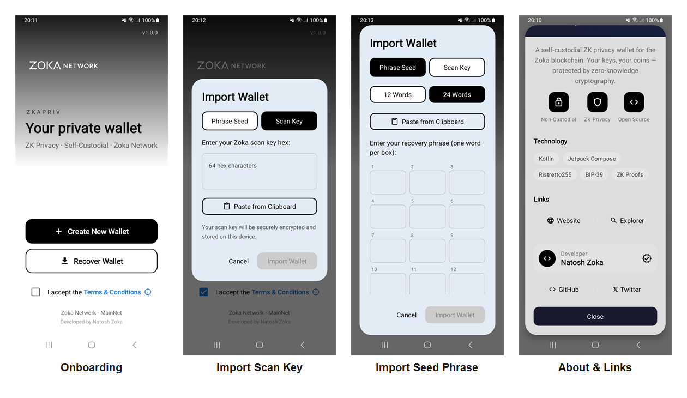

# ZKAPriv — Wallet privada para la red Zoka




**ZKAPriv** es la billetera móvil oficial de la **red Zoka (ZKA)**, una cadena
de pagos con privacidad por defecto. Cada transferencia usa direcciones
sigilosas (*stealth addresses*) y montos cifrados, de modo que el saldo y el
historial de una cuenta solo son visibles para quien posee sus claves.

> ZKAPriv no es un fork de propósito general: está construida específicamente
> para el protocolo privado de Zoka (Ristretto255 + notas cifradas + nullifiers).

---

## Características

- **Privacidad real por transacción.** Direcciones de un solo uso derivadas por
  ECDH sobre Ristretto255; los montos viajan cifrados y solo el receptor los
  puede descifrar con su *scan key*.
- **Modelo de dos claves.** Cada cuenta tiene una **scan key** (detectar fondos
  entrantes) y una **spend key** (gastarlos), derivadas de una frase mnemónica
  BIP39.
- **Multicuenta.** Varias cuentas independientes en un mismo dispositivo, cada
  una con su color, nombre y dirección `zka1…`.
- **Escaneo de saldo on-chain.** La app reconstruye el saldo recorriendo la
  cadena y descifrando las salidas que le pertenecen, sin depender de un
  servidor que conozca tu identidad.
- **Seguridad del dispositivo.** Bloqueo por PIN y biometría, almacenamiento
  cifrado de claves y bloqueo automático de sesión.
- **Conexión directa a nodos Zoka.** RPC configurable con nodo primario y
  *fallback* de respaldo.

---

## Arquitectura

ZKAPriv es un proyecto Android multi-módulo (Kotlin + Jetpack Compose):

| Módulo | Responsabilidad |
|--------|-----------------|
| `app` | Punto de entrada, navegación, tema e inyección de dependencias (Hilt). |
| `core`    | Modelos compartidos, utilidades y criptografía base (`Ristretto255`, `Bech32`). |
| `network` | Cliente RPC del nodo Zoka, repositorio de saldos y transacciones privadas. |
| `security` | Gestión de cuentas, derivación de claves, mnemónicos, keystore y biometría. |
| `price` | Cotización y estadísticas de mercado de ZKA. |
| `ui` | Pantallas de Compose: dashboard, enviar/recibir, cuentas, ajustes, etc. |

### Criptografía (resumen)

- Curva: **Ristretto255**.
- Dirección de pago interna: `zpriv:<scan_pub_hex>:<spend_pub_hex>`.
- Dirección de usuario: `zka1` + Base58(`scan_pub‖spend_pub‖checksum`).
- Derivación de salida: `derived = H("zoka-output-key" ‖ shared ‖ commitment)`,
  `one_time_pubkey = spend_pub + derived·G`.
- Detección de propiedad: el receptor recomputa la clave de un solo uso con su
  *scan scalar* y la compara con la salida en cadena.
- Gasto: cada nota produce un **nullifier** determinista que evita el doble
  gasto sin revelar qué salida se gastó.

---

## Compilación

Requisitos: Android Studio (AGP 8.x), JDK 17, Android SDK con NDK (la app
incluye criptografía nativa para ARMv7 y ARM64).

```bash
# Debug
./gradlew assembleDebug

# Release
./gradlew assembleRelease

# Instalar en un dispositivo conectado (sin borrar datos)
adb install -r app/build/outputs/apk/release/app-release.apk
```

El APK de release queda en `app/build/outputs/apk/release/`.

---

## Configuración de red

Los endpoints RPC del nodo Zoka se definen en el módulo `core`
(`Constants.kt`) y pueden ajustarse desde **Ajustes → Red** dentro de la app:

- **RPC primario** y **RPC de respaldo** (*fallback*) para tolerar caídas.

---

## Seguridad

- Las claves (mnemónico, scan/spend) **nunca salen del dispositivo** sin acción
  explícita del usuario y se guardan cifradas.
- No subas al repositorio: `keystore.properties`, `local.properties`, claves de
  firma, ni ningún archivo con seeds o tokens.
- Guarda tu frase de recuperación fuera de línea: es la única forma de
  restaurar una cuenta.

---

## Estado

En desarrollo activo, conectada a la red Zoka. Las funciones de privacidad
están operativas; el roadmap del protocolo se mantiene en el repositorio del
nodo Zoka.

---

## Licencia

Distribuido bajo licencia **MIT**. Ver el archivo [LICENSE](LICENSE).

© 2025 Zoka Network.
